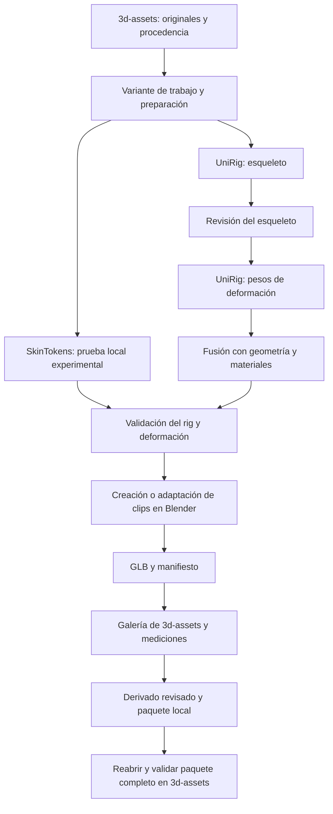

# Plan del laboratorio de rigging del proyecto 3d-assets

Fecha: 22 de octubre de 2026. Revisión 5. Estado: diagnóstico, instalación UniRig, ejemplo oficial y dos candidatos del corpus ejecutados en `3d-assets`. Galería local con comparación y poses estáticas disponible; pesos del humano requieren revisión antes de clips. La evidencia de cada ejecución se conserva en `lab/reports/`.

**El proyecto `3d-assets` será el lugar de trabajo de todo el laboratorio:** selección, preparación de mallas, rigging, corrección, animación, revisión visual, medición y empaquetado. La inferencia se realizará localmente en el equipo del creador de contenidos. El resultado será una biblioteca de recursos preparados y paquetes GLB reproducibles, independientes de una aplicación consumidora.

Code Studio y Sócrates serán consumidores futuros. Su implementación comenzará después de completar y validar todo el flujo en `3d-assets`, mediante planes separados. El alcance actual termina con paquetes revisados que se pueden abrir y reproducir desde este proyecto.

La ruta principal será **UniRig en WSL2, con una etapa y un modelo a la vez**. SkinTokens tendrá un entorno independiente y una evaluación experimental acotada: el equipo dispone de 8 GB de VRAM y su documentación exige al menos 14 GB. El laboratorio puede incorporar ambos motores, pero considerar SkinTokens operativo en esta GPU depende de una prueba completa con evidencia. [UniRig](https://github.com/VAST-AI-Research/UniRig), [SkinTokens](https://github.com/VAST-AI-Research/SkinTokens).

## Contexto y resultado esperado

El propósito es proporcionar sets ya preparados para visualizar y controlar, trabajando con una RTX 3060 Ti de 8 GB. La biblioteca del propio proyecto aporta 342 modelos, de los cuales 12 tienen esqueleto y 13 contienen animaciones según su [índice](../INDEX.md).

El primer resultado útil será un paquete con un humano y un cuadrúpedo preparados, cada uno con dos clips revisados, procedencia, configuración reproducible y tiempos medidos. Los controles ya animados permitirán comprobar el visor antes de atribuir un fallo a los modelos de IA. El segundo resultado será una comparación de motores que distinga éxito, falta de memoria, error de dependencia y calidad insuficiente.

Alcance inicial: inferencia local, revisión en Blender, creación o adaptación de clips, exportación GLB, ampliación de la galería existente, medición y empaquetado. El entrenamiento de modelos, los servicios cloud y los cambios en Code Studio o Sócrates quedan fuera de este laboratorio.

## Estado de implementación

El [manual del laboratorio](../lab/README.md) contiene los comandos implementados y el [informe de instalación](../lab/reports/UNIRIG-SETUP.md) documenta la prueba real aprobada. El diagnóstico, instalación, verificación y smoke test ya tienen CLI y registro de ejecuciones. El estado observado se resume en `lab/reports/unirig-install.json`; los resultados GPU y checkpoints tienen sus propios manifiestos. Un comando implementado no implica que su última ejecución haya pasado.

El segundo corte prepara `Man` y `Wolf` sin sus rigs ni clips, conserva controles normalizados del rig original y ejecuta UniRig con su propio esqueleto generado. La galería compara cinco poses estáticas por modelo, muestra esqueletos, métricas y exporta notas. El [informe del corpus](../lab/reports/CORPUS-REVIEW.md) documenta resultados y límites. Los candidatos siguen sin aprobación final: el humano requiere revisar rodilla y codos. Clips, promoción de derivados, paquetes y evaluación SkinTokens siguen pendientes. El perro sentado queda como caso difícil posterior.

El receptor de `creation-lab` también está implementado y verificado con un candidato estático: `ingest` valida y copia evidencia; `rig --candidate` genera el rig y restaura escala/apariencia originales. El [informe del adaptador](../lab/reports/CREATION-ADAPTER.md) delimita esa prueba. El [estado de relevo](../lab/STATUS.md) y [skill de rigging](../.agents/skills/gg3d-rigging/SKILL.md) concentran decisiones y comandos vigentes. La aprobación de deformaciones continúa pendiente.

## Base existente y autonomía del proyecto

El repositorio `3d-assets` ya contiene [el catálogo](CATALOG.md), los originales en `models/`, metadatos, índices, licencias y una [galería local](../gallery.html). Su [visor](../gallery/app.js) carga GLB, enumera clips, permite seleccionarlos y reproduce o pausa la animación. Los componentes visuales y recursos se sirven localmente.

Se ampliará esa base con navegación de variantes y resultados, comparación, velocidad y reinicio de clips. Blender será la herramienta inicial para inspeccionar huesos y pesos. La galería seguirá abriendo sin instalar los entornos de IA; las dependencias pesadas se limitarán a los comandos de inferencia.

Todos los comandos, rutas de datos, locks, pruebas y reportes se resolverán desde la raíz de `3d-assets`. El laboratorio deberá funcionar desde un clon autónomo del repositorio, sin depender de `makecode`, sus scripts compartidos ni los repositorios de las aplicaciones consumidoras.

## Equipo y compatibilidad

El diagnóstico inicial en WSL encontró los valores siguientes. Memoria libre, disco y PATH son observaciones históricas; para el estado actual consultar `lab/STATUS.md`, los recibos y `doctor`. Las notas de compatibilidad se actualizan aquí con la instalación comprobada:

| Componente | Estado observado | Consecuencia para el plan |
| --- | --- | --- |
| GPU | NVIDIA GeForce RTX 3060 Ti, 8192 MiB | UniRig cumple el mínimo nominal; SkinTokens queda por debajo del mínimo oficial |
| VRAM libre | 4450 MiB en el momento de la consulta | Antes de medir, liberar cargas GPU que el usuario pueda cerrar y volver a consultar; este valor varía |
| Driver Windows | 610.88 | CUDA y kernels del entorno UniRig verificados; SkinTokens pendiente |
| Sistema | Ubuntu 26.04.1 LTS, WSL2 | Combinación de wheels UniRig fijada y verificada en esta distribución |
| Memoria de WSL | 15 GiB totales; 12 GiB disponibles; swap de 4 GiB | Compilar extensiones con pocos procesos y medir RAM además de VRAM |
| Disco Linux | 901 G disponibles en el volumen virtual | Confirmar espacio físico del volumen Windows que aloja el VHD antes de descargar |
| Herramientas en PATH | `python3` encontrado; `uv`, `conda`, `nvcc`, `blender` no encontrados | uv/Python 3.11 están en lab/.local; el perfil actual no necesita nvcc ni Blender ejecutable |

Reservar inicialmente **50 GiB de espacio físico** para dos entornos, pesos, cachés, compilación y resultados. Es un presupuesto del laboratorio, ajustable después de inventariar descargas; no es el tamaño oficial de los modelos. La RAM de WSL y el swap no sustituyen VRAM de CUDA.

En WSL se conservará el driver de Windows. Si una extensión necesita compilación, instalar únicamente el CUDA Toolkit compatible; la presencia de `nvidia-smi` no demuestra que exista `nvcc`. [Guía NVIDIA para WSL](https://docs.nvidia.com/cuda/wsl-user-guide/index.html).

### Entornos separados

| Componente | UniRig | SkinTokens |
| --- | --- | --- |
| Python | 3.11 | 3.11 |
| PyTorch | 2.5.1 + CUDA 12.4, torchvision 0.20.1; combinación verificada y fijada en perfil/lock | 2.7.0, torchvision 0.22.0, torchaudio 2.7.0, wheels CUDA 12.8 según instalación oficial |
| NumPy | 1.26.4 según instalación oficial | Resolver dentro del rango upstream y fijar después de probar |
| Transformers | 4.51.3 | Rango upstream desde 4.57.0; fijar la versión validada |
| Blender Python | `bpy==4.2.0` verificado | `bpy>=4.2`; fijar la versión validada |
| Extensiones | FlashAttention, spconv, torch_scatter y torch_cluster | FlashAttention y dependencias del proyecto |
| Perfil GPU | Batch 1 y precisión de inferencia upstream | Batch 1 upstream; perfil de 8 GB experimental |

Referencias: [requisitos UniRig](https://raw.githubusercontent.com/VAST-AI-Research/UniRig/main/requirements.txt), [requisitos SkinTokens](https://raw.githubusercontent.com/VAST-AI-Research/SkinTokens/main/requirements.txt), [instalación SkinTokens](https://github.com/VAST-AI-Research/SkinTokens#-installation).

Usar `uv` y un entorno Python por motor como primera opción. La selección UniRig ya está fijada en `lab/envs/unirig.profile.json` y su lock, con kernels e inferencia comprobados. Ante una migración del entorno, volver a verificar esa combinación antes de atribuirle compatibilidad. Revisar la [matriz PyG](https://pytorch-geometric.readthedocs.io/en/latest/install/installation.html) y [FlashAttention](https://github.com/Dao-AILab/flash-attention#installation-and-features); no resolver dependencias mediante actualizaciones globales sucesivas.

Si Ubuntu 26.04 impide una combinación reproducible, preparar como alternativa un entorno Linux compatible mediante contenedor con GPU, conservando los mismos datos y scripts. Esa alternativa requiere verificar su runtime y herramientas; no se considerará instalada por existir este plan.

## Arquitectura del laboratorio



UniRig y SkinTokens serán **motores alternativos sobre una misma entrada preparada**. Encadenar el esqueleto de UniRig con SkinTokens mediante `--use_skeleton` se reservará para un experimento posterior, después de conocer el comportamiento independiente de ambos.

El esqueleto define articulaciones; los pesos indican cómo deforman la malla. Los clips especifican cómo cambian esas articulaciones en el tiempo. Una exportación con rig todavía necesita clips para ofrecer acciones como caminar o saludar.

Estructura de destino. El catálogo, la galería y las herramientas de publicación ya existen; `lab/`, `derived/` y `packs/` se crearán al implementar:

```text
3d-assets/
  README.md
  models/<ID>/                  # originales y su procedencia, ya existentes
  index.json                    # índice original, ya existente
  gallery.html                  # galería existente
  gallery/                      # visor, componentes y dependencias locales existentes
  tools/                        # catálogo, servidor, construcción y validación existentes
  docs/RIGGING-LAB-PLAN.md       # plan canónico de este laboratorio
  lab/
    README.md
    lab.cmd                     # lanzador Windows hacia WSL, propio del repositorio
    lab.py                      # interfaz de los comandos del laboratorio
    envs/                       # restricciones y locks por motor
    configs/                    # perfiles upstream y experimentales
    scripts/                    # preparar, inferir, animar, exportar y validar
    patches/                    # modificaciones upstream explícitas
    corpus/manifest.json        # referencias a originales y variantes
    tests/                      # flujo local, errores, integridad y regresión
    reports/                    # conclusiones y evidencia pequeña
    .local/                     # repos, entornos, pesos, cachés y runs ignorados
  derived/
    index.json                  # índice separado de derivados revisados
    <asset>/<variant>/<version>/ # GLB, fuente editable, manifiesto y revisión
  packs/
    index.json                  # inventario de paquetes terminados
    <pack>/<version>/           # recursos seleccionados, créditos y manifiesto
```

Los originales de `models/` y sus metadatos permanecen como fuente de verdad de entrada. Cada preparación crea una variante con hash propio. El laboratorio no leerá ni sincronizará automáticamente la copia histórica del catálogo ubicada fuera de `3d-assets`.

El [verificador actual](../tools/check_site.py) exige que las entradas de `index.json` apunten a `models/`. Por eso, los derivados tendrán un índice separado con `sourceId`, hash original, variante, motor, perfil, clips y revisión. `tools/catalog.py verify` seguirá verificando originales; la validación del laboratorio comprobará además derivados y paquetes.

Los experimentos intermedios se guardarán en `lab/.local/runs/<runId>/`. Solo se promoverán a `derived/` resultados revisados, conservando el GLB, la fuente editable de Blender y su evidencia. La creación de `packs/` seleccionará versiones concretas de esos derivados, con inventario y hashes. Los pesos, entornos, cachés y repositorios de terceros permanecerán ignorados por Git.

El ciclo de cada variante será `prepared` → `rigged` → `animated` → `validated` → `reviewed` → `packaged`. Estos estados describen el recurso; el estado técnico de una ejecución se registrará por separado. Repetir una etapa creará un nuevo run y no sobrescribirá una versión revisada. La galería distinguirá originales, experimentos locales y derivados revisados.

Cada motor implementará las mismas operaciones del laboratorio: diagnóstico, preparación, inferencia, validación y reporte. La interfaz propuesta será `python lab/lab.py <comando>`, ejecutada desde `3d-assets`, con `doctor`, `setup`, `prepare`, `rig`, `validate`, `review`, `benchmark`, `view` y `package`. `review` registrará la revisión; la edición y creación de clips se hará en Blender mediante los scripts previstos. Estos nombres describen comandos por construir, no disponibles hoy.

Cada ejecución registrará ID, entrada y SHA-256, motor, commit, revisión y hash de pesos, entorno, perfil, semilla cuando aplique, etapas, tiempos, memoria, archivos producidos y estado final. Un resultado solo pasará a `success` cuando sus archivos superen la validación; crear un archivo o devolver código cero no basta.

## Corpus inicial

Se usarán seis fuentes ya descargadas. Los conteos de huesos y clips provienen del GLB inspeccionado; los de triángulos son datos de la API y se recalcularán sobre la geometría real antes de comparar rendimiento.

| Fuente | ID local | Triángulos API | Huesos y clips | Papel |
| --- | --- | ---: | --- | --- |
| Teacher | `5v5j_lqOHTO` | 252 | 0 y 0 | Humano estático; revisar pose y separación de extremidades |
| Dog | `24WsfFi7Q8s` | 378 | 0 y 0 | Cuadrúpedo estático inicial |
| Bird | `8Ph79kHbt9s` | 386 | 0 y 0 | Prueba de alas y estructura distinta |
| Man | `HMnuH5geEG` | 1216 | 31 y 11 | Control humano animado y fuente de una copia sin rig |
| Wolf | `P1gU3Qkr9r` | 1928 | 51 y 24 | Control cuadrúpedo y fuente de una copia sin rig |
| Frog | `9Z2V8fpazF` | 0, dato no útil | 28 y 4 | Control adicional de reproducción y exportación |

Fichas: [Teacher](../models/5v5j_lqOHTO/metadata.json), [Dog](../models/24WsfFi7Q8s/metadata.json), [Bird](../models/8Ph79kHbt9s/metadata.json), [Man](../models/HMnuH5geEG/metadata.json), [Wolf](../models/P1gU3Qkr9r/metadata.json), [Frog](../models/9Z2V8fpazF/metadata.json).

Habrá ocho variantes: tres mallas estáticas, tres controles animados originales y dos copias sin rig de Man/Wolf. Estas últimas conservarán la geometría en pose de reposo y sus materiales, con registro de transformación. Los rigs existentes son referencias de comparación, no una anatomía universal que los modelos deban reproducir exactamente.

Antes de inferir se comprobarán escala, eje frontal, pose, normales, componentes sueltos, degenerados, materiales y separación de extremidades. Se aplicará la misma preparación a ambos motores. Si Teacher tiene una pose inadecuada, el humano inicial será la variante sin rig de Man. Los modelos de mobiliario o mecanismos rígidos no necesitarán autorigging por defecto.

## Fases y criterios de salida

### Fase 0 Diagnóstico y contrato de resultados

1. Guardar inventario de GPU, VRAM libre, RAM, CPU, WSL, disco físico y herramientas.
2. Confirmar visibilidad de la GPU en WSL y construir la matriz candidata de Python, PyTorch, CUDA y extensiones.
3. Definir manifiesto de entradas, estructura de resultados y estados `success`, `oom`, `dependency_error`, `invalid_output`, `quality_rejected` y `cancelled`.
4. Preparar ejecución serial y cancelación que cierre únicamente procesos creados por el laboratorio.
5. Definir la raíz autónoma `3d-assets`, los índices separados y las exclusiones de trabajo local. Antes de instalar entornos, delimitar el escaneo de `tools/check_site.py` para excluir únicamente dependencias y cachés locales, manteniendo la revisión de código propio y del inventario publicable.

**Salida:** diagnóstico reproducible, matriz candidata y espacio disponible. La compatibilidad efectiva de los entornos se comprobará en la fase siguiente.

### Fase 1 Instalación reproducible

1. Recuperar los repositorios oficiales y fijar commit, sin actualizar automáticamente checkouts existentes.
2. Crear y verificar primero el entorno de UniRig; abordar el entorno de SkinTokens en su fase experimental. Validar imports y ejecutar un kernel CUDA mínimo con la precisión de cada motor antes de congelar su resolución. Limitar inicialmente a dos trabajos de compilación por la RAM disponible en WSL. Un fallo de kernel o extensión bloquea la inferencia de ese entorno.
3. Descargar únicamente pesos de inferencia y configuraciones necesarias, con revisión y SHA-256. Separar descarga de medición.
4. Guardar las licencias del código, dependencias y pesos junto con el manifiesto de herramientas.
5. Preparar los ejemplos oficiales y comprobar su lectura; ejecutar la inferencia en las fases específicas de cada motor.

UniRig publica aproximadamente 1,44 GB para esqueleto y 4,38 GB para skinning: [checkpoint de esqueleto](https://huggingface.co/VAST-AI/UniRig/tree/main/skeleton/articulation-xl_quantization_256), [checkpoint de skinning](https://huggingface.co/VAST-AI/UniRig/tree/main/skin/articulation-xl). El [descargador upstream](https://raw.githubusercontent.com/VAST-AI-Research/UniRig/main/src/inference/download.py) deberá quedar asociado a revisiones registradas en el laboratorio.

SkinTokens dispone de [pesos públicos](https://huggingface.co/VAST-AI/SkinTokens); no se necesita su dataset de entrenamiento para este alcance. La etiqueta MIT de la raíz no sustituye los avisos de componentes incorporados, como aclara su [issue sobre Michelangelo](https://github.com/VAST-AI-Research/SkinTokens/issues/9).

**Salida:** locks, inventario de pesos, imports y kernels mínimos verificados. UniRig ya tiene smoke y corpus ejecutados según los informes del estado vigente; la inferencia local de SkinTokens sigue pendiente. Una instalación nueva debe comprobarse de nuevo.

### Fase 2 Preparación del corpus y ampliación de la galería

1. Crear las ocho variantes e inspeccionar geometría real.
2. Ampliar la galería existente con selector de originales/variantes/derivados, reinicio, velocidad y comparación. Reutilizar su carga GLB, listado de clips y reproducción/pausa. Inspeccionar huesos y pesos en Blender durante este primer corte.
3. Verificar primero Man, Wolf y Frog originales; revisar selección de clips, cámara, materiales y animación independiente de dos instancias.
4. Permitir comparar entrada, rig bruto y versión corregida. Mostrar siempre qué transformación se está viendo.
5. Adaptar el servidor local para exponer a la galería solo los archivos de runs seleccionados mediante un inventario validado; los entornos y pesos permanecerán fuera de esas rutas. La galería publicable seguirá funcionando sin el backend del laboratorio.

**Salida:** tres controles reproducidos, navegación de variantes dentro de `3d-assets`, manifiesto con hashes y capturas de referencia. La galería original conservará búsqueda, filtros, atribuciones y funcionamiento sin conexión.

### Fase 3 UniRig en 8 GB

Ejecutar primero el ejemplo oficial de jirafa y luego Dog y el humano elegido. La secuencia upstream, desde su checkout y con rutas preparadas por el laboratorio, es:

```bash
bash launch/inference/generate_skeleton.sh \
  --input input/model.glb --output results/model_skeleton.fbx --seed 42

# Revisar en Blender y guardar malla + armature como model_reviewed.fbx.
bash launch/inference/generate_skin.sh \
  --input results/model_reviewed.fbx --output results/model_skin.fbx --seed 42

bash launch/inference/merge.sh \
  --source results/model_skin.fbx --target input/model.glb \
  --output results/model_rigged.glb
```

Los comandos proceden de los launchers de [esqueleto](https://raw.githubusercontent.com/VAST-AI-Research/UniRig/main/launch/inference/generate_skeleton.sh), [skinning](https://raw.githubusercontent.com/VAST-AI-Research/UniRig/main/launch/inference/generate_skin.sh) y [fusión](https://raw.githubusercontent.com/VAST-AI-Research/UniRig/main/launch/inference/merge.sh). El archivo usado en la fusión debe contener pesos, además del esqueleto.

El wrapper creará rutas de staging controladas, sin espacios ni caracteres de shell, y serializará trabajos porque los launchers comparten temporales. También validará artefactos y logs aunque el script termine correctamente. Los comandos upstream usan `eval` y no propagan todos los fallos intermedios de forma fiable.

Se probará primero la configuración oficial. Ante falta de memoria: repetir tras recuperar VRAM disponible y después evaluar el tamaño de bloque de skinning 512 → 256 → 128. Son variantes registradas de [`num_train_vertex`](https://raw.githubusercontent.com/VAST-AI-Research/UniRig/main/configs/model/unirig_skin.yaml), usado también en [inferencia](https://raw.githubusercontent.com/VAST-AI-Research/UniRig/main/src/model/unirig_skin.py). Esto no elimina la memoria del encoder. Cambiar el muestreo será otro experimento y requerirá reevaluar calidad; simplificar caras por sí solo no garantiza resolver memoria.

**Salida:** dos rigs con pesos válidos, materiales conservados, deformaciones revisadas y consumos registrados. Si solo funciona una etapa, reportarla como parcial y resolverla antes de considerar UniRig operativo.

### Fase 4 SkinTokens experimental en 8 GB

El runner normal detectará que la GPU está por debajo de los 14 GB documentados. El perfil experimental permitirá ejecutar deliberadamente una prueba con un solo modelo y un solo proceso, registrando esa condición.

```bash
# Desde el checkout SkinTokens, con entorno y pesos preparados.
python demo.py --input input/model.glb --output results/model_rigged.glb \
  --use_transfer --num_beams 1
```

`--num_beams 1` modifica el valor upstream de 10; `--use_transfer` solicita conservar la apariencia de entrada. La [CLI real](https://raw.githubusercontent.com/VAST-AI-Research/SkinTokens/main/demo.py) ya usa batch 1 y no ofrece `--low-vram`, `--device` ni `--seed`. No se documentarán como soluciones disponibles.

Secuencia de evaluación:

1. Probar una malla pequeña con beam 1, pesos completos y configuración de precisión upstream; capturar la fase exacta de cualquier OOM.
2. Si falla por memoria, evaluar un único parche acotado de inferencia sin gradientes y modo evaluación, después de comprobar el camino de llamadas. Conservar diff y comparar salida. Es una hipótesis técnica, no una garantía de reducción suficiente.
3. Si produce salida, repetir con humano y cuadrúpedo; validar geometría, pesos, materiales y calidad antes de medir el corpus.
4. Si no cabe después de esos intentos, cerrar la evaluación como `oom` y mantener SkinTokens preparado para una GPU con memoria suficiente. No sustituir ese resultado por una comparación ficticia de tiempos.

Asignar **4–8 horas de ingeniería** a esta investigación. Cuantización, descarga de capas a CPU o reescritura del modelo serían otro alcance, porque upstream utiliza CUDA de forma explícita. El laboratorio seguirá siendo local; no habrá cambio automático a AWS.

La CLI inicia un proceso auxiliar Blender. El runner deberá comprobar disponibilidad del puerto local, recoger sus logs y cerrarlo al finalizar o cancelar. La interfaz Gradio no es necesaria para el flujo inicial.

**Salida:** tres ejecuciones válidas por cada uno de dos modelos, o un informe reproducible con `oom`, `dependency_error` o `invalid_output`, según la causa. Si no se pudo instalar una dependencia, la viabilidad de inferencia queda sin evaluar y la preparación de ese motor permanece parcial. Un smoke test aislado no certifica todo el catálogo.

### Fase 5 Animación y empaquetado

1. Revisar huesos, jerarquía y pesos en Blender con poses diagnósticas de hombros/caderas, rodillas/codos y cola o alas según el modelo.
2. Preparar `idle` y `wave` para el humano; `idle` y `walk` para el cuadrúpedo. Usar creación manual o adaptación de animaciones compatibles con procedencia registrada.
3. Hornear restricciones y controladores a canales de transformación exportables. Una animación existente solo se transferirá después de mapear huesos y comprobar proporciones.
4. Exportar GLB con geometría, texturas, esqueleto y clips. Usar nombres estables y conservar un mapa desde nombres originales.
5. Validar el contenedor con [glTF Validator](https://github.com/KhronosGroup/glTF-Validator), revisar nuevamente el GLB en Blender y probarlo en el visor.
6. Promover el derivado revisado a `derived/`, conservando fuente editable y evidencia, y construir en `packs/` un paquete con GLB, miniatura, manifiesto, créditos, cambios, hashes y reporte de calidad.

El manifiesto incluirá `assetId`, versión, fuente y licencia, hash del original y derivado, motor y perfil, escala/unidad, orientación, huesos y clips. Cada clip tendrá ID, nombre exportado, duración, repetición sugerida y tratamiento del desplazamiento del personaje. El valor inicial será movimiento sobre el lugar: el runtime controla la posición del objeto para evitar desplazamientos duplicados.

Presupuesto inicial propuesto para el pack educativo: **hasta 5 MiB por GLB, 20 000 vértices, 64 huesos, cuatro influencias por vértice, ocho clips y diez segundos por clip**. Son objetivos de exportación del laboratorio sujetos a medición, no una certificación de compatibilidad con aplicaciones consumidoras ni restricciones universales de glTF. Al reducir influencias, renormalizar pesos y volver a revisar deformaciones.

**Salida:** dos recursos nuevos con cuatro clips en total, más controles conservados. Los clips deben cambiar la pose real de la malla, no limitarse a mover el nodo raíz.

### Fase 6 Cierre completo dentro de 3d-assets

1. Repetir el recorrido selección → preparación → rigging → corrección → clips → validación → revisión en galería → empaquetado para el humano y el cuadrúpedo.
2. Abrir cada paquete terminado desde una carpeta limpia con el visor local, usando solamente sus archivos y las dependencias visuales locales. Comprobar clips, materiales, hashes y créditos con la red desactivada.
3. Verificar que el laboratorio funciona desde un clon autónomo de `3d-assets`, tras preparar sus herramientas y pesos, sin rutas ni imports de otros proyectos. La galería por sí sola debe seguir funcionando sin GPU ni entornos de IA.
4. Comprobar repetición y cancelación de runs, conservación de originales y versiones revisadas, y regeneración de manifiestos sin resultados duplicados.
5. Ejecutar las comprobaciones existentes de catálogo/sitio y las del laboratorio. Mantener las pruebas GPU locales separadas de la validación del sitio, que no debe necesitar CUDA.
6. Guardar en `lab/reports/` el informe de cierre, los comandos, las versiones de paquetes terminados y el estado independiente de cada motor. Documentar el procedimiento para preparar un modelo nuevo.

**Salida:** flujo completo y reproducible en `3d-assets`, dos paquetes o un paquete que contenga ambos recursos, revisión registrada y manual de operación. Solo después de este cierre se abrirá el trabajo de integración en una plataforma consumidora.

## Medición y comparación

Medir cada etapa por separado: importación y preparación, carga del modelo, generación, skinning cuando corresponda, transferencia/exportación, validación y corrección manual. Separar instalación y descargas de la inferencia.

| Dato | Método y uso |
| --- | --- |
| Tiempo total por modelo | Reloj monotónico del runner; incluye conversiones y arranque, excluye instalación/descarga |
| Tiempo de ejecución por etapa | Reloj monotónico con sincronización CUDA antes y después; incluye trabajo CPU. Usar CUDA Events o profiler si se necesita aislar tiempo GPU |
| Memoria GPU | Pico asignado/reservado de PyTorch y muestreo de memoria de dispositivo; identificar consumo ajeno y limitaciones WSL |
| RAM | Pico de proceso y auxiliares, con intervalos de muestreo documentados |
| Complejidad | Vértices, caras, componentes, huesos, materiales, resolución de texturas y puntos muestreados |
| Calidad | Huesos faltantes, deformación, preservación de materiales, coherencia de clips y minutos de corrección |
| Fiabilidad | Éxitos, OOM y errores con denominador y logs; conservar intentos fallidos |

Por configuración viable: tres repeticiones sobre la misma entrada y perfil, con pesos ya descargados. Informar mediana y rango; tres muestras no justifican percentiles de cola. Distinguir procesos nuevos con caché en disco de inferencia con modelo residente, si el runner llegara a soportar esta última.

Para comparar calidad, conservar la salida bruta de cada motor. Las correcciones humanas formarán una variante separada y sumarán al tiempo de producción. Usar semilla 42 en UniRig; si se incorpora semilla al wrapper SkinTokens, registrar el parche y las bibliotecas sembradas. La misma semilla numérica no implica muestras equivalentes entre motores.

La primera tanda será Dog y humano. Después se añadirá Bird y las variantes sin rig restantes. No procesar los 342 modelos hasta conocer qué categorías necesitan rig y qué tasa de corrección manual resulta sostenible.

El coste operativo por recurso se evaluará como tiempo automático más intervención manual. La estimación de capacidad diaria partirá de esas mediciones; no se asignarán ahora segundos o minutos por modelo sin resultados locales.

## Paquetes locales y entrega posterior

El cierre de este plan produce paquetes locales versionados en `3d-assets`. El [constructor del sitio](../tools/build_site.py) utiliza un inventario explícito: los runs, pesos, entornos y borradores del laboratorio no se publicarán. La promoción de derivados o paquetes a la galería publicable deberá incorporarse explícitamente a ese inventario y a sus comprobaciones; producir un pack local no disparará un despliegue.

La entrega futura a Code Studio o Sócrates consistirá en GLB, manifiesto de clips, procedencia, atribuciones, hashes y evidencia del visor. Sus importadores, cuotas, controles y adaptadores se evaluarán en sus propios proyectos después de cerrar la fase 6. Este plan no incluye tareas de implementación, pruebas de producto ni estimaciones para esas integraciones.

## Criterios de aceptación del laboratorio

| ID | Resultado verificable |
| --- | --- |
| RIG 01 | Diagnóstico identifica hardware, versiones, espacio físico y capacidad CUDA |
| RIG 02 | UniRig instalado reproduciblemente; SkinTokens con entorno reproducible o bloqueo de dependencia identificado. Commits, locks y hashes conservados para cada instalación completada |
| RIG 03 | Originales preservados y cada variante enlazada con su procedencia |
| RIG 04 | UniRig completa esqueleto, pesos y GLB de dos modelos en esta GPU |
| RIG 05 | SkinTokens tiene resultado local documentado: inferencia viable, OOM, salida inválida o dependencia bloqueante; solo el primer caso cuenta como motor operativo |
| RIG 06 | Validación comprueba articulaciones referenciadas, pesos finitos normalizados y ausencia de vértices deformables sin asignación |
| RIG 07 | Humano y cuadrúpedo tienen dos clips útiles cada uno, sin pérdida visible de materiales ni deformaciones graves |
| RIG 08 | Visor reproduce controles y resultados, con dos instancias independientes y cancelación correcta |
| RIG 09 | Reporte separa arranque, inferencia, conversión, memoria y trabajo manual |
| RIG 10 | Pack incluye atribuciones, cambios, clips y hashes; abre sin recursos externos |
| RIG 11 | El flujo completo funciona desde un clon autónomo de `3d-assets`, sin dependencias de otros proyectos |
| RIG 12 | Galería y catálogo originales conservan sus verificaciones; índices de originales, derivados y paquetes permanecen separados |
| RIG 13 | Cada paquete se reabre desde una carpeta limpia y sin red; el informe de fase 6 registra el cierre y el estado de ambos motores |

La aceptación se realizará íntegramente en `3d-assets`. La integración con aplicaciones consumidoras comenzará posteriormente y tendrá sus propios criterios, definidos sobre los paquetes ya terminados.

## Orden de trabajo y esfuerzo estimado

Estimación de ingeniería para una persona, no tiempos de inferencia ni compromiso de calendario. Descargas, compilaciones largas y corrección artística compleja pueden extender el tiempo transcurrido.

| Orden | Entrega | Esfuerzo |
| --- | --- | --- |
| 1 | Diagnóstico, contrato de runs y matriz de dependencias | 2–3 h |
| 2 | Entornos, pesos e instalación verificable | 3–6 h |
| 3 | Corpus y ampliación de la galería con controles conocidos | 3–5 h |
| 4 | Pipeline UniRig y validación en dos modelos | 4–6 h |
| 5 | Evaluación acotada SkinTokens 8 GB | 4–8 h |
| 6 | Clips, empaquetado y comparación medida | 6–10 h |
| 7 | Cierre autónomo, reapertura de packs y documentación de uso | 2–3 h |
| | **Laboratorio y primer pack en 3d-assets** | **24–41 h** |

La primera comprobación decisiva será **un GLB generado por UniRig que deforme correctamente y pueda revisarse en `3d-assets`**. La ampliación de la galería con recursos existentes puede avanzar en paralelo a la instalación. SkinTokens se evaluará después de estabilizar las mediciones, y su resultado no retrasará la preparación del primer pack con la ruta viable.

El laboratorio estará terminado cuando el recorrido completo y los paquetes estén validados dentro de `3d-assets`, con un resultado explícito de viabilidad para cada motor. SkinTokens solo contará como operativo si completa sus pruebas en 8 GB. Ese cierre habilita la planificación posterior de integración en Code Studio o Sócrates.
